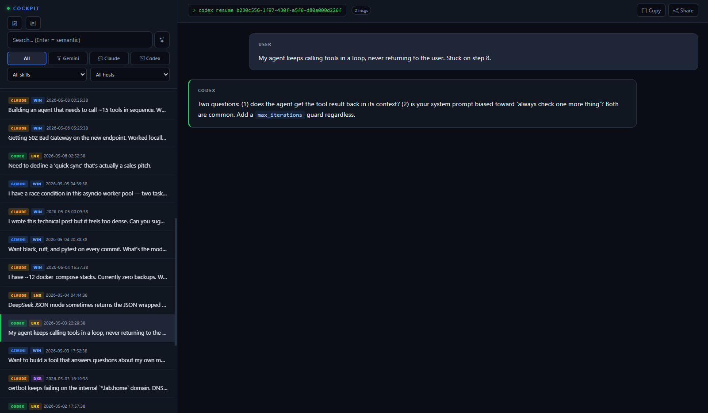

# cockpit

Self-hosted search, audit and memory dashboard for Claude Code, Codex CLI and Gemini CLI sessions, built for people who run AI assistants across several machines.

  



## Overview

CLI assistants write `.jsonl` session logs under `~/.claude/`, `~/.codex/` and `~/.gemini/`
on every machine they run on, with no global search and no way to ask "what did I work on
last Thursday?". Cockpit collects those logs on one server (pushed by cron + rsync), indexes
them for hybrid keyword/semantic search, produces a nightly LLM-written audit of the day, and
distills the history into memory files that can be injected back into the next assistant
session's system prompt.

## Features

- Indexes Claude Code, Codex CLI and Gemini CLI sessions, plus optional web-app captures (ChatGPT, Gemini, Claude) dropped as JSON.
- Searches with chunk-level BM25 (accent-insensitive), optional Gemini embeddings, Reciprocal Rank Fusion and optional LLM reranking.
- Answers natural-language questions from a distilled notes journal with cited dates (`POST /api/ask`, "Ask the Panopticon").
- Generates a daily "Ops Brief" as structured JSON: headline, narrative, workstreams, open/resolved threads, focus score, per-chat categories.
- Maintains two memory layers for prompt injection: a 30-day rolling `user-memory.md` and a long-term `user-core.md` that changes only by contradiction, with its size limit enforced by code.
- Builds the active pending-items list deterministically (similarity grouping, close matching, 14-day TTL) and lets the user kill items from a CLI (`app/pendencias.py`).
- Builds a weekly digest across the last 7 daily audits on demand.
- Renders a category heatmap over the stored audit days (up to 30), per-source badges (Claude/Gemini/Codex/web) and per-host badges (WIN/LNX/DKR/WEB).
- Ships a seed script with fictional data for demos and evaluation.

## How it works

```
 client machines                         cockpit server (Docker)
 ───────────────                         ──────────────────────────────────────────────
 ~/.claude/projects/  ── cron rsync ──>  data/claude/<client>/      ┐
 ~/.codex/sessions/   ── cron rsync ──>  data/codex/<client>/       ├─> cockpit.py index worker
 ~/.gemini/tmp/*/chats ─ convert+rsync > data/gemini/<client>/      │     (every INDEX_INTERVAL s)
 web captures (opt.)  ─────────────────> data/*_site/               │     BM25 + embeddings
 notes journal (opt.) ─────────────────> data/brain/journal/        ┘
                                                                         │
                                   HTTP :8000  <── /api/search, /api/ask, /api/memory/*, UI
                                                                         │
 external scheduler, daily ──> docker exec cockpit python /app/daily_auditor.py
                                 └─> daily_audit.json ─> ai_config/user-memory.md, user-core.md
```

- `app/cockpit.py` is a single-file server on the Python stdlib `http.server` (no web
  framework). A background thread rescans the data directories, converts Claude `.jsonl` to
  normalized `.json`, rebuilds the BM25 index and incrementally embeds new chats. The UI is one
  HTML string served from the same file.
- Sync is push-only: each client rsyncs its own logs over SSH. The server never connects out to
  clients.
- `app/daily_auditor.py` is run once a day by an external scheduler (cron, n8n, etc.). Day
  membership is decided by message timestamps, not file mtime, and each chat is sampled
  head + middle + tail under a per-chat character budget. DeepSeek (`DEEPSEEK_MODEL`, thinking
  disabled) is the primary LLM, Gemini the fallback. The LLM proposes open/resolved threads;
  the `## Pendências ativas` block of `user-memory.md` is then computed in Python
  (`build_pendencias_block()`), because prompt rules alone kept closed items alive.
- `app/memory_distiller.py` runs from the index worker at 23:45 local time and only processes
  sessions tagged with `MEMORY_SKILL` via `POST /api/skill_log`.
- `scripts/promote.py` regenerates `app/` from a private production copy, sanitizing names and
  checking for leaked secrets. The repository is a one-way mirror of production code.

See [docs/ARCHITECTURE.md](docs/ARCHITECTURE.md) and
[docs/MEMORY-PIPELINE.md](docs/MEMORY-PIPELINE.md) for the details.

## Requirements

- Docker with Docker Compose (server), or Python 3.11 with `requests`, `rank-bm25`, `numpy`.
- Bash, `rsync` and SSH key access to the server on each client machine; `python3` on clients
  that sync Gemini CLI logs.
- Optional API keys: DeepSeek and/or Google Gemini (audits, digests, embeddings), OpenAI
  (reranking and `/api/ask`).
- An external scheduler (cron or similar) if you want the daily audit to run automatically.

## Quick start

1. Clone and configure:

   ```bash
   git clone https://github.com/cascodigital/cockpit.git
   cd cockpit
   cp .env.example .env    # optionally add DEEPSEEK_API_KEY / GEMINI_API_KEY / OPENAI_API_KEY
   ```

2. Seed fictional data (sessions over the last 14 days, a matching audit history, a sample journal and memory files):

   ```bash
   python3 scripts/demo/seed-data.py --data-dir ./data
   ```

3. Start the server:

   ```bash
   docker compose up -d --build
   ```

4. Check the index and open the UI at `http://localhost:8000`:

   ```bash
   curl -s http://localhost:8000/api/search/status
   ```

## Configuration

Server variables (set in `.env`, passed through `docker-compose.yml`). Full reference:
[docs/CONFIGURATION.md](docs/CONFIGURATION.md).

| Variable / key | Required | Default | Description |
|---|---|---|---|
| `PORT` | no | `8000` | Host port published by Compose (the container listens on 8000) |
| `TZ` | no | `UTC` | Container timezone; the 23:45 memory-distiller trigger uses local time |
| `INDEX_INTERVAL` | no | `150` | Seconds between filesystem index scans |
| `GEMINI_DATA`, `CLAUDE_DATA`, `CLAUDE_CONVERTED`, `CODEX_DATA` | no | `/app/data/<source>` | Session directories inside the container |
| `CHATGPT_SITE_DATA`, `GEMINI_SITE_DATA`, `CLAUDE_SITE_DATA` | no | `/app/data/<source>_site` | Optional web-capture directories (`machine=WEB`) |
| `BRAIN_DATA` | no | `/app/data/brain` | Optional notes vault with `journal/YYYY-MM-DD.md` files |
| `DEEPSEEK_API_KEY` | no | empty | Primary LLM for daily audits, memory files, weekly digest, memory profile |
| `DEEPSEEK_MODEL` | no | `deepseek-flash` | DeepSeek model for every LLM call above; thinking mode is sent as disabled |
| `GEMINI_API_KEY` | no | empty | LLM fallback and embeddings provider for semantic search |
| `OPENAI_API_KEY` | no | empty | Enables LLM reranking and `/api/ask` |
| `RERANK_MODEL` / `RERANK_TOP` | no | `gpt-4o-mini` / `30` | Reranking model and number of candidates reranked |
| `ASK_MODEL` | no | `gpt-4o-mini` | Model answering `/api/ask` |
| `ASK_CHAR_BUDGET` / `ASK_RECENT_DAYS` | no | `90000` / `5` | Journal context cap and newest days always included |
| `MEMORY_SKILL` | no | empty | Skill slug whose sessions feed the memory profile; empty disables it |
| `NO_PENDING_SKILLS` | no | empty | Comma-separated skill slugs whose sessions never create pending items |
| `USER_NAME` / `PERSONA_NAME` | no | `the user` / `the auditor` | Names interpolated into the audit and memory prompts |

Client sync variables (`scripts/sync/.env`): `COCKPIT_HOST`, `COCKPIT_USER`,
`COCKPIT_DATA_ROOT`, `CLIENT_NAME`. See [scripts/sync/README.md](scripts/sync/README.md).

Each LLM feature degrades independently: with no keys, indexing, BM25 search, the journal panel
and the UI still work.

## Usage

Sync from a client machine (repeat per machine, keep only the scripts you need):

```bash
cd scripts/sync && cp .env.example .env    # set COCKPIT_HOST, COCKPIT_USER, COCKPIT_DATA_ROOT, CLIENT_NAME
ssh-copy-id "$COCKPIT_USER@$COCKPIT_HOST"
crontab -e
# */5 * * * * /path/to/cockpit/scripts/sync/claude_sync.sh
# */5 * * * * /path/to/cockpit/scripts/sync/codex_sync.sh
# */5 * * * * /path/to/cockpit/scripts/sync/gemini_sync.sh
```

Run the daily audit (defaults to yesterday; pass a date to catch up):

```bash
docker exec cockpit python /app/daily_auditor.py 2026-08-04
```

List the active pending items injected into memory, and kill the ones that are done
(`mata` = "kill"; the item and its rewordings stay out of future runs):

```bash
docker exec cockpit python /app/pendencias.py
docker exec cockpit python /app/pendencias.py mata 2 5
```

HTTP API:

| Endpoint | Method | Description |
|---|---|---|
| `/` | GET | Web UI |
| `/api/chats` | GET | Metadata of all indexed sessions |
| `/api/chat/<uid>` | GET | Full messages of one session |
| `/api/search` | POST | Hybrid search, body `{"query": "..."}`, returns `{results, journal}` |
| `/api/ask` | POST | Journal Q&A, body `{"question": "..."}`, returns `{answer, sources, model}` |
| `/api/journal` | GET | Journal files from `BRAIN_DATA`, newest first |
| `/api/search/status` | GET | Index health (BM25 and embedding counts) |
| `/api/memory/daily` | GET | Daily audit history (`daily_audit.json`) |
| `/api/memory/weekly` | GET | Regenerates and returns the weekly digest (one LLM call) |
| `/api/memory/ludovico` | GET | Memory profile (`memory_profile.json`) |
| `/api/memory/core` | GET | Long-term memory layer (`ai_config/user-core.md`) |
| `/api/memory/memoria` | GET | Short-term memory layer (`ai_config/user-memory.md`) |
| `/api/skill_log` | POST | Record a skill activation, body `{"skill": "...", "agent": "claude"}` |

## Limitations

- No authentication. Bind to a trusted network or put it behind a reverse proxy with auth.
- Single tenant: all clients land in one index.
- The UI text and the LLM prompts are in Portuguese, so audits and `/api/ask` answers are
  produced in Portuguese. Prompt tone is an opinionated, sarcastic persona; edit the
  `prompt_text` blocks to change it (keep the JSON shape, the UI parses it).
- The daily audit converts timestamps with a fixed UTC-3 offset (`BRT` in `daily_auditor.py`).
- Pending-item matching relies on Portuguese markers produced by the prompt (`[fecha quando: ...]`,
  passive verbs such as `Monitorar`) and recognizes ticket IDs only with the prefixes `SUP`, `IT`,
  `INC` and `RITM`.
- Rerank and `/api/ask` call `https://api.openai.com/v1` directly; the endpoint is not
  configurable, so local OpenAI-compatible servers are not supported in the current code.
- The Codex parser is best-effort; the Codex JSONL format has changed before.
- `app/` is regenerated from a private production copy by `scripts/promote.py`; direct edits to
  `app/` are overwritten by the next promote.

## License

MIT — see [LICENSE](LICENSE).
